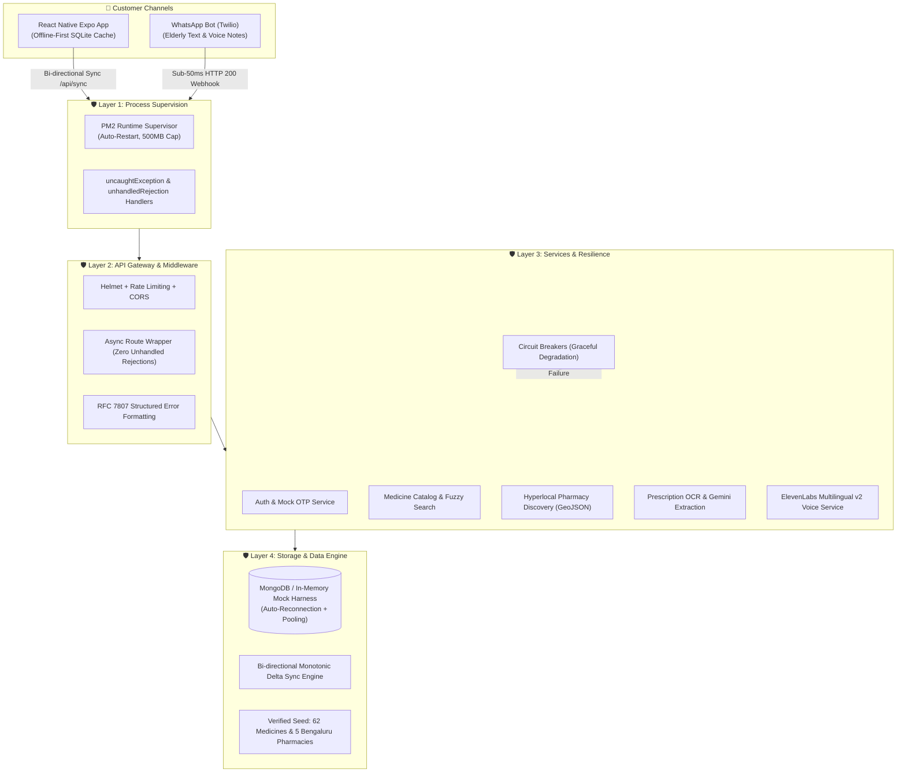

# 🌿 Quick Sanjeevani (क्विक संजीवनी / ಕ್ವಿಕ್ ಸಂಜೀವನಿ)
### *Your Healthcare, All in One Place.*

[](https://devnovate.com)
[](#)
[-43A047?style=for-the-badge)](#)
[](LICENSE)

> **wHACKiest 2026 Online Ideathon (26–27 Nov 2026)**  
> **Team Name:** Hot Chocolate Fudge  
> **College:** Presidency University, Bengaluru  
> **Track:** Track 3 — Know Thyself  
> **Team Members:**  
> - **Ansh Vasant** (Lead) — `20251CSE0622`  
> - **MN Malathesh** — `20251CSE0634`  
>
> 📊 **Official 8-Slide Pitch Deck:** [`presentation/HotChocolateFudge_Track3.pptx`](presentation/HotChocolateFudge_Track3.pptx)

---

## 🎯 Executive Summary & Problem

Healthcare information, prescription history, chronic medication refills, and pharmacy access are fundamentally fragmented across paper records, multiple disparate e-pharmacies, and unorganized messaging channels. In India:
- **140M+ elderly citizens (60+)** struggle with complex apps, fine-print interfaces, and multi-step checkouts.
- **60% of elderly adults take chronic medications daily** (NSSO 75th Round).
- **72% of households store prescriptions physically**, leading to lost documents, missed doses, and medication non-adherence.
- Existing platforms (Tata 1mg, PharmEasy, Apollo 24/7) utilize centralized warehouse fulfillment models that take 24–48 hours, lack true offline access, and offer zero native voice assistance in Indian languages for senior citizens.

### Our Solution
**Quick Sanjeevani** is an **offline-first personal healthcare companion** paired with an **automated WhatsApp voice bot** designed specifically for elderly patients. 
A 70-year-old grandparent can simply send a voice note in **Hindi or Kannada** (*"meri dawai khatam ho rahi hai"*) or snap a photo of a doctor's prescription. Quick Sanjeevani extracts the medicines with OCR, verifies local stock in real-time across neighborhood pharmacies in Bengaluru, sends spoken reminders via ElevenLabs AI voice, and syncs seamlessly with an offline-first mobile app.

---

## 🌟 Key Differentiators & Innovation (USPs)

| Feature | Tata 1mg / PharmEasy | Apollo 24/7 | **Quick Sanjeevani** |
|:---|:---:|:---:|:---:|
| **Elderly WhatsApp Voice Bot** | ❌ None | ❌ None | **✅ Native WhatsApp bot + Voice Notes in Hindi/Kannada** |
| **Offline-First Architecture** | ❌ Web-only | ❌ Online-only | **✅ Full offline operation via SQLite/WatermelonDB** |
| **Pharmacy Network** | ❌ Central warehouse | ⚠️ Chain stores | **✅ Hyperlocal neighborhood chemist network (sub-30 min)** |
| **Prescription OCR + AI** | ⚠️ Upload only | ⚠️ Upload only | **✅ Auto-extraction, dosage parsing & safety flags** |
| **4-Layer Crash Resilience** | ❌ Standard | ❌ Standard | **✅ Supervised, auto-reconnecting, circuit-breakered API** |
| **Multilingual Voice (TTS)** | ❌ None | ❌ None | **✅ ElevenLabs Multilingual v2 Voice Synthesis** |

---

## 🏗️ System Architecture & 4-Layer Crash Resilience

Previous hackathon architectures frequently crash under unhandled promise rejections, connection drops, or external API timeouts. Quick Sanjeevani enforces **4 distinct layers of defense**:



---

## 📦 Monorepo Structure

```
Quick_Sanjeevani/
├── presentation/
│   └── HotChocolateFudge_Track3.pptx # Official 8-Slide Pitch Deck
├── server/                           # Crash-Resilient Node.js Backend API
│   ├── src/
│   │   ├── config/                   # Process, database & environment guards
│   │   ├── middleware/               # Async error wrappers & RFC 7807 formatters
│   │   ├── models/                   # Mongoose schemas (User, Medicine, Pharmacy, Prescription, Sync)
│   │   ├── routes/                   # Modular REST endpoints (/api/medicines, /api/pharmacies, etc.)
│   │   ├── services/                 # Business logic & Circuit Breaker services
│   │   └── seeds/                    # 62 clinically categorized medicines & 5 geo-tagged pharmacies
│   └── tests/                        # 48 Unit & Resilience integration tests
├── mobile/                           # React Native Expo Mobile App
│   ├── src/
│   │   ├── components/               # ErrorBoundary, Custom Headers, Cards
│   │   ├── database/                 # SQLite / WatermelonDB offline schema & sync client
│   │   ├── screens/                  # Dashboard, MedicineSearch, Prescriptions, Settings
│   │   └── services/                 # Offline-first API & Sync services
│   └── tests/                        # Offline catalog & UI component tests
├── whatsapp-bot/                     # Elderly WhatsApp Bot Service
│   ├── src/
│   │   ├── services/                 # Intent recognition, OCR.space, ElevenLabs TTS, Twilio
│   │   ├── templates/                # Regional Hindi, Kannada & English message templates
│   │   └── webhook.js                # Sub-50ms instant ACK webhook processor
│   └── tests/                        # Webhook & intent parsing tests (33 tests)
├── tests/                            # 4-Tier Zero-Dependency E2E Integration Suite
│   ├── e2e-runner.js                 # Complete system test runner (66 tests, 137ms)
│   ├── helpers/                      # Ephemeral mock harness via Windows Named Pipes
│   └── suites/                       # Tier 1 (Features), Tier 2 (Boundaries), Tier 3 (Combos), Tier 4 (Real-World)
├── ecosystem.config.js               # PM2 multi-service configuration
└── TEST_READY.md                     # Certified test run verification report
```

---

## 🚀 Quick Start Guide

### Prerequisites
- Node.js >= 18.0.0
- npm or yarn

### 1. Installation
Clone the repository and install all dependencies across workspace packages:
```bash
git clone https://github.com/KIJ-JIK/Quick_Sanjeevani.git
cd Quick_Sanjeevani
npm install
```

### 2. Run Comprehensive Test Suite
Verify that all 4 tiers of contracts and crash-resilience pass 100%:
```bash
node tests/e2e-runner.js
```
*Expected output: `ALL TESTS PASSED (100%) - 66/66 test cases across all 4 tiers in <150ms`.*

### 3. Start the Backend API
```bash
cd server
npm start
```
Check health: `curl http://localhost:5000/health` → `{"status":"healthy","uptime":...}`

### 4. Start the WhatsApp Bot Service
```bash
cd whatsapp-bot
npm start
```
Twilio Webhook listener runs on port 3001.

### 5. Launch the Mobile Application
```bash
cd mobile
npm start
```
Scan the Expo QR code with Expo Go on Android or iOS.

---

## 🏆 Sponsor Technology Integrations

- **ElevenLabs Multilingual v2**: Synthesizes natural, human-sounding voice notes in **Hindi** and **Kannada** for non-tech-literate senior citizens who cannot read small smartphone screens.
- **AWS-Ready Cloud Infrastructure**: Architecture is built on decoupled micro-services ready to containerize directly to **AWS ECS / EKS** with **Amazon S3** for secure prescription image storage.

---

## 📄 License
This project is open-source under the [MIT License](LICENSE).
